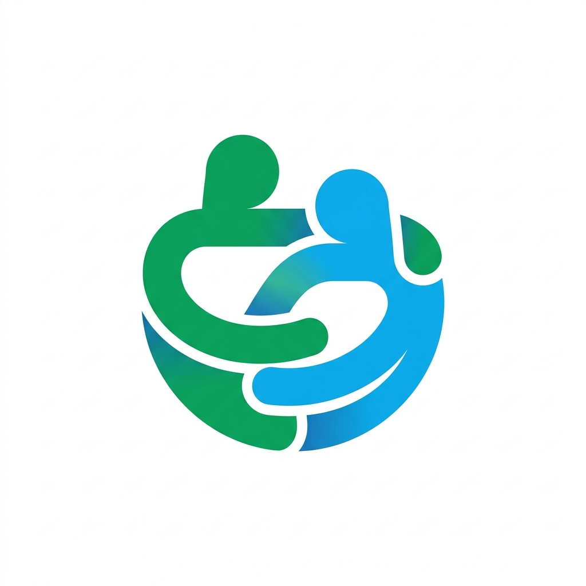

<p align="center">
  
</p>

<h1 align="center">RUANG TUMBUH</h1>

<p align="center">
  <strong>Pusat Bantuan Konseling Online Remaja Bermuatan Nilai Kearifan Lokal</strong><br>
  <em>Konstruksi Model Teoritis Konseling Online untuk Meningkatkan Well-Being Remaja dengan Ide Bunuh Diri</em>
</p>

<p align="center">
  
  
  
  
  
  
</p>

---

## 📌 Tentang Ruang Tumbuh

**Ruang Tumbuh** adalah platform kesehatan mental dan konseling online berbasis web yang dikembangkan khusus untuk mendukung remaja (khususnya siswa tingkat sekolah menengah/SLTA). Platform ini mengintegrasikan **Konstruksi Model Teoritis Konseling Online Bermuatan Nilai Kearifan Lokal**, teori *Psychological Well-Being* (Carol D. Ryff), serta pendekatan konseling kognitif dan berfokus solusi.

Platform ini bertujuan mendeteksi dini risiko kesehatan mental, memfasilitasi pendampingan konseling daring bersama konselor profesional/sebaya, serta meningkatkan resiliensi dan kesejahteraan psikologis remaja yang menghadapi tekanan emosional, stres akademik, krisis identitas, maupun indikasi risiko ide bunuh diri.

Program ini didukung oleh **Diktisaintek Kemendiktisaintek** bekerja sama dengan konsorsium akademisi bimbingan konseling dan psikologi pendidikan lintas perguruan tinggi:
* **Universitas Negeri Malang (UM)**
* **Universitas Pendidikan Indonesia (UPI)**
* **Universitas Negeri Padang (UNP)**
* **Universitas Negeri Yogyakarta (UNY)**

---

## 🚀 Fitur Utama Sistem

### 📊 1. Asesmen Psikologis & Skrining Risiko Terpadu
* **Instrumen Psychological Well-Being**: Mengukur 6 dimensi kesejahteraan psikologis model Carol D. Ryff (Otonomi, Penguasaan Lingkungan, Pertumbuhan Pribadi, Hubungan Positif dengan Orang Lain, Tujuan Hidup, dan Penerimaan Diri).
* **Deteksi Dini Ide Bunuh Diri**: Skrining 12 butir instrumen untuk mengidentifikasi tingkat kerentanan emosional secara aman dan rahasia.
* **Auto-Save & Reaktif**: Pengerjaan instrumen menyimpan jawaban konseli secara otomatis (*real-time auto-save*).
* **Interpretasi Skor Otomatis**: Hasil asesmen dikalkulasikan secara otomatis ke dalam kategori (Tinggi, Sedang, Rendah) lengkap dengan visualisasi grafik radar/batang.
* **Ekspor Laporan PDF**: Unduh hasil asesmen dalam format PDF resmi untuk dokumentasi konseling atau rujukan klinis.

### 🤝 2. Layanan Konseling Online Berkelanjutan
* **Pemilihan Konselor**: Konseli bebas memilih konselor bimbingan konseling yang terdaftar di dalam platform.
* **Ruang Sesi Konseling**: Interaksi terstruktur meliputi catatan sesi, eksplorasi masalah, evaluasi progres, dan perencanaan tindak lanjut.
* **Lembar Refleksi Diri**: Panduan refleksi mandiri terarah yang membantu konseli mengenali kekuatan internal (*inner strength*) serta potensi solusi.

### 📚 3. Modul Materi Edukasi & Pembelajaran (Lessons)
* Modul pembelajaran multimedia mandiri yang dirancang konselor/admin.
* Mendukung beragam format materi: teks naratif, gambar ilustrasi, video panduan, sematan video YouTube, hingga unduhan dokumen PDF.
* Disusun untuk memperkuat pemahaman remaja seputar regulasi emosi, resiliensi diri, dan nilai kearifan lokal Nusantara.

### 👨‍🏫 4. Panel Konselor (Bimbingan Konseling)
* Dashboard statistik konseli aktif dan ringkasan sesi.
* Pemantauan hasil asesmen *well-being* dan notifikasi tingkat risiko konseli secara mendalam.
* Fasilitas pencatatan log konseling, evaluasi refleksi konseli, serta pembuatan modul materi edukasi (*lessons*).

### 👑 5. Panel Administrator Komprehensif
* **Manajemen Pengguna**: Kontrol hak akses multi-role (Admin, Konselor, Konseli).
* **Manajemen Profil Konselor**: Kurasi profil, keahlian, dan ketersediaan konselor sekolah.
* **Manajemen Instrumen**: Pengelolaan bank butir soal asesmen, grup opsi jawaban (skala Likert), dan konfigurasi rumus interpretasi skor.
* **Manajemen Lesson**: Pengelolaan konten edukasi terintegrasi untuk seluruh konseli.

---

## 🛠️ Arsitektur & Teknologi

| Komponen | Teknologi | Keterangan |
| :--- | :--- | :--- |
| **Backend** | Laravel 11.x | PHP 8.2+ dengan arsitektur MVC modern |
| **Database** | MySQL / MariaDB | Relasional database dengan Eloquent ORM |
| **Frontend UI** | Blade + Tailwind CSS | Desain responsif, clean, dan playful modern |
| **Reaktivitas** | Alpine.js | Manajemen status interaktif & auto-save jawaban |
| **Build Tool** | Vite 6.x | Kompilasi aset CSS dan JavaScript cepat |
| **PDF Generator**| Dompdf / Barryvdh Dompdf | Konversi laporan asesmen ke dokumen PDF |

---

## 📂 Struktur Direktori Proyek

```
ruangtumbuh/
├── app/
│   ├── Http/
│   │   ├── Controllers/
│   │   │   ├── Admin/           # Controller Panel Admin (Instrumen, User, Konselor, Lesson)
│   │   │   ├── Konseli/         # Controller Panel Konseli (Wellbeing, Sesi, Refleksi, Lesson)
│   │   │   └── Konselor/        # Controller Panel Konselor (Monitoring, Review, Sesi, Lesson)
│   │   └── Middleware/         # Pengatur Hak Akses Berbasis Role (admin, konselor, konseli)
│   └── Models/                  # Model Eloquent (User, Question, OptionGroup, Interpretation, Lesson, dll)
├── database/
│   ├── migrations/              # Definisi struktur tabel & relasi database
│   └── seeders/                 # Seeder data master instrumen, interpretasi, dan akun default
├── docs/                        # Dokumentasi panduan pengguna (Admin, Konseli, Konselor) & screenshot
├── public/
│   ├── build/                   # File hasil kompilasi Vite
│   └── image/                   # Aset logo, ilustrasi konseling, dan identitas universitas
├── resources/
│   ├── css/                     # Konfigurasi Tailwind CSS
│   ├── js/                      # Inisialisasi JavaScript & Alpine.js
│   └── views/                   # Template Blade terstruktur per role pengguna
│       ├── admin/               # Tampilan antarmuka Administrator
│       ├── konseli/             # Tampilan antarmuka Siswa/Konseli
│       ├── konselor/            # Tampilan antarmuka Guru BK/Konselor
│       ├── layouts/             # Layout dasar (Base, Admin, Konselor, Konseli)
│       └── landing.blade.php    # Halaman utama (Public Landing Page)
└── routes/
    └── web.php                  # Definisi rute aplikasi & grouping middleware
```

---

## 🔧 Panduan Instalasi Lokal

Ikuti langkah-langkah berikut untuk menjalankan sistem **Ruang Tumbuh** di lingkungan lokal:

### 1. Prasyarat Sistem
* PHP >= 8.2 (ekstensi: `pdo_mysql`, `mbstring`, `openssl`, `gd`, `xml`, `curl`)
* Composer >= 2.x
* Node.js >= 18.x & NPM
* Server Database MySQL atau MariaDB

### 2. Kloning Repositori
```bash
git clone https://github.com/username/ruangtumbuh.git
cd ruangtumbuh
```

### 3. Instalasi Dependensi
```bash
# Instal dependensi PHP
composer install

# Instal dependensi JavaScript & Tailwind CSS
npm install
```

### 4. Konfigurasi Lingkungan (.env)
Salin berkas template lingkungan:
```bash
cp .env.example .env
```
Buka berkas `.env` dan sesuaikan koneksi database Anda:
```env
APP_NAME="Ruang Tumbuh"
APP_URL=http://127.0.0.1:8000

DB_CONNECTION=mysql
DB_HOST=127.0.0.1
DB_PORT=3306
DB_DATABASE=ruangtumbuh
DB_USERNAME=root
DB_PASSWORD=
```

### 5. Generate Key & Tautan Berkas Storage
```bash
php artisan key:generate
php artisan storage:link
```

### 6. Migrasi & Pengisian Data Awal (Seeding)
Jalankan migrasi database beserta seeder bawaan (instrumen asesmen, skala pilihan, dan data contoh):
```bash
php artisan migrate --seed
```

### 7. Menjalankan Server Pengembangan
Buka 2 terminal terpisah atau jalankan secara bersamaan:

```bash
# Terminal 1: Laravel Backend Server
php artisan serve

# Terminal 2: Vite Hot-Reload Compiler
npm run dev
```

Buka peramban (browser) dan akses alamat:  
👉 **`http://127.0.0.1:8000`** atau **`http://localhost:8000`**

---

## 👥 Tim Peneliti & Pengembang

Platform dan model teoretis ini dirumuskan dan dikembangkan oleh tim akademisi bimbingan konseling dan psikologi:

1. **Prof. Dr. M. Ramli, M.A** – *Guru Besar Bimbingan & Konseling, Universitas Negeri Malang*
2. **Prof. Dr. Juntika Nurihsan, M.Pd** – *Guru Besar Bimbingan & Konseling, Universitas Pendidikan Indonesia*
3. **Prof. Dr. Zadrian Ardi, S.Pd., M.Pd., Kons** – *Guru Besar Bimbingan & Konseling, Universitas Negeri Padang*
4. **Prof. Dr. Nur Hidayah, M.Pd** – *Guru Besar Bimbingan & Konseling, Universitas Negeri Malang*
5. **Dr. Nur Mega Aris Saputra, S.Pd., M.Pd** – *Dosen & Peneliti Utama, Universitas Negeri Malang*
6. **Dr. Juwanto, S.Pd.I., M.Pd** – *Dosen & Pengembang Model, Universitas Negeri Malang*
7. **Ade Herdian Putra, S.Pd., M.Pd. Kons** – *Konselor & Pengembang Layanan, Universitas Negeri Padang*

---

## 📞 Alamat & Kontak Resmi

* **Institusi Pengembang**: Departemen Bimbingan dan Konseling, Fakultas Ilmu Pendidikan, Universitas Negeri Malang (UM)
* **Alamat**: Jl. Semarang No. 5 Kota Malang, Jawa Timur 65145
* **WhatsApp**: [+62 812-3175-0634](https://wa.me/6281231750634)
* **Email Resmi**: [aris.saputra.fip@um.ac.id](mailto:aris.saputra.fip@um.ac.id)
* **Layanan Bantuan Krisis Darurat 24 Jam**: Hotline SEJIWA Kemenkes **119 ext 8** (Bebas Pulsa)

---

## 📄 Lisensi & Hak Cipta

&copy; 2026 **Ruang Tumbuh** &bull; Hak Cipta dilindungi undang-undang.  
Dikembangkan untuk kepentingan akademis, riset, serta pengabdian masyarakat di bawah konsorsium riset Diktisaintek Kemendiktisaintek bersama Universitas Negeri Malang, UPI, UNP, dan UNY.
