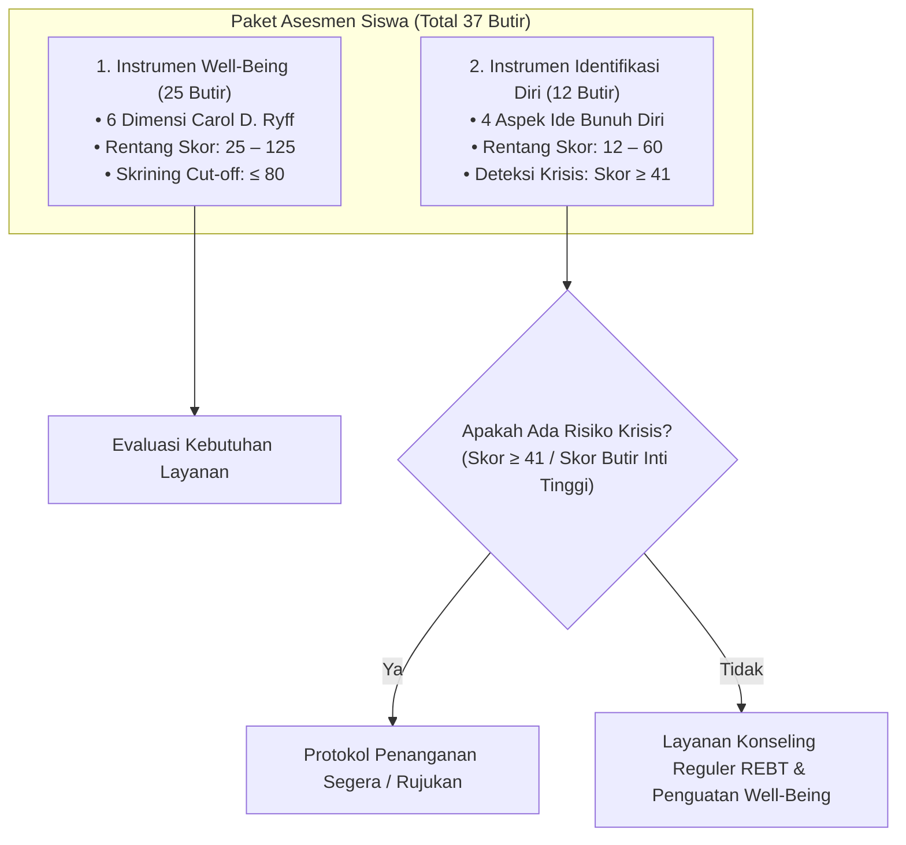

# Instrumen Pengukuran Psikologis — RuangTumbuh.com

| Informasi Dokumen | Detail |
| :--- | :--- |
| **Nama Dokumen** | Spesifikasi Instrumen Pengukuran Psychological Well-Being & Identifikasi Diri (Ide Bunuh Diri) |
| **Proyek** | RuangTumbuh.com — Konseling Online Bermuatan Kearifan Lokal |
| **Landasan Teori** | *Psychological Well-Being* (Carol D. Ryff) & Asesmen Risiko Ide Bunuh Diri |
| **Target Pengguna** | Siswa / Remaja (SMP/SMA/Sederajat) |
| **Waktu Pengisian** | **Awal Konseling** (Pre-Test) & **Sesudah Konseling** (Post-Test) |
| **Status Dokumen** | Acuan Baku Pengembangan Sistem (Development Reference) |

---

## 1. Ikhtisar & Arsitektur Instrumen

Platform **RuangTumbuh.com** mengintegrasikan dua instrumen utama yang diisi secara mandiri oleh konseli sebelum sesi konseling (Awal) dan setelah menyelesaikan rangkaian konseling (Sesudah):



---

## 2. Bagian 1: Instrumen Psychological Well-Being (25 Butir)

### 2.1. Kisi-Kisi & Blueprint Dimensi Well-Being

Instrumen kesejahteraan psikologis diadaptasi dari teori *Psychological Well-Being* Carol D. Ryff yang mencakup 6 dimensi utama:

| Dimensi | Indikator | Butir (+) (*Favorable*) | Butir (−) (*Unfavorable*) | Jumlah Butir |
| :--- | :--- | :---: | :---: | :---: |
| **1. Penerimaan Diri** | Menerima kelebihan dan kekurangan diri; nyaman menjadi diri sendiri; tidak larut menyesali masa lalu | 1, 3 | 2, 4 | 4 |
| **2. Relasi Positif** | Memiliki hubungan hangat dan saling percaya; menghargai perbedaan; merasa dipedulikan | 5, 7 | 6, 8 | 4 |
| **3. Otonomi** | Mampu mengambil keputusan sendiri; percaya diri; tidak mudah terbawa tekanan orang lain | 9, 11 | 10, 12 | 4 |
| **4. Penguasaan Lingkungan** | Mampu mengatur tuntutan sehari-hari; memanfaatkan kesempatan; merasa mampu mengendalikan hidup | 13, 15 | 14, 16 | 4 |
| **5. Tujuan Hidup** | Memiliki arah, tujuan, dan cita-cita; merasa hidup bermakna | 17, 19 | 18, 20 | 4 |
| **6. Pertumbuhan Pribadi** | Terus mengembangkan diri; terbuka pada pengalaman baru; belajar dari kesalahan | 21, 23, 25 | 22, 24 | 5 |
| **Total** | | **13** | **12** | **25** |

---

### 2.2. Daftar Butir Pernyataan Well-Being & Pedoman Skoring

#### Pilihan Skala Respons
- **STS**: Sangat Tidak Setuju
- **TS**: Tidak Setuju
- **N**: Netral
- **S**: Setuju
- **SS**: Sangat Setuju

> [!IMPORTANT]
> **Aturan Pembobotan Sistem (Scoring Algorithm):**
> - **Butir Positif (+ / *Favorable*)**: STS = 1, TS = 2, N = 3, S = 4, SS = 5. (Makin setuju, well-being makin tinggi).
> - **Butir Negatif (- / *Unfavorable*)**: STS = 5, TS = 4, N = 3, S = 2, SS = 1. (Makin tidak setuju, well-being makin tinggi / skor dibalik).

| No | Dimensi | Pernyataan | Sifat | STS | TS | N | S | SS |
| :-: | :--- | :--- | :-: | :-: | :-: | :-: | :-: | :-: |
| 1 | Penerimaan Diri | Saya menerima kondisi diri saya apa adanya. | (+) | 1 | 2 | 3 | 4 | 5 |
| 2 | Penerimaan Diri | Saya sulit menerima kekurangan yang ada pada diri saya. | (−) | 5 | 4 | 3 | 2 | 1 |
| 3 | Penerimaan Diri | Saya merasa nyaman menjadi diri sendiri di tengah keluarga dan teman-teman saya. | (+) | 1 | 2 | 3 | 4 | 5 |
| 4 | Penerimaan Diri | Saya sering menyesali diri sendiri atas hal-hal yang sudah terjadi. | (−) | 5 | 4 | 3 | 2 | 1 |
| 5 | Relasi Positif | Saya memiliki hubungan yang hangat dan saling percaya dengan orang-orang di sekitar saya. | (+) | 1 | 2 | 3 | 4 | 5 |
| 6 | Relasi Positif | Saya merasa sulit menjalin kedekatan dengan orang lain. | (−) | 5 | 4 | 3 | 2 | 1 |
| 7 | Relasi Positif | Saya bisa menghargai perbedaan pendapat teman tanpa harus memusuhi mereka. | (+) | 1 | 2 | 3 | 4 | 5 |
| 8 | Relasi Positif | Saya merasa tidak ada orang yang benar-benar peduli dengan saya. | (−) | 5 | 4 | 3 | 2 | 1 |
| 9 | Otonomi | Saya mampu mengambil keputusan penting tanpa harus selalu bergantung pada orang lain. | (+) | 1 | 2 | 3 | 4 | 5 |
| 10 | Otonomi | Saya merasa tidak percaya diri mengambil keputusan sendiri. | (−) | 5 | 4 | 3 | 2 | 1 |
| 11 | Otonomi | Saya berani menghadapi tantangan baru meski harus melakukannya sendiri. | (+) | 1 | 2 | 3 | 4 | 5 |
| 12 | Otonomi | Saya mudah terpengaruh pendapat orang lain meski bertentangan dengan keyakinan saya. | (−) | 5 | 4 | 3 | 2 | 1 |
| 13 | Penguasaan Lingkungan | Saya mampu mengatur tuntutan sekolah dan kehidupan sehari-hari saya dengan baik. | (+) | 1 | 2 | 3 | 4 | 5 |
| 14 | Penguasaan Lingkungan | Saya merasa kewalahan mengurus tanggung jawab sehari-hari saya. | (−) | 5 | 4 | 3 | 2 | 1 |
| 15 | Penguasaan Lingkungan | Saya bisa memanfaatkan kesempatan di sekitar saya untuk mencapai tujuan saya. | (+) | 1 | 2 | 3 | 4 | 5 |
| 16 | Penguasaan Lingkungan | Saya merasa tidak mampu mengendalikan hal-hal penting yang terjadi dalam hidup saya. | (−) | 5 | 4 | 3 | 2 | 1 |
| 17 | Tujuan Hidup | Saya punya arah dan tujuan yang jelas dalam menjalani hidup saya. | (+) | 1 | 2 | 3 | 4 | 5 |
| 18 | Tujuan Hidup | Saya merasa hidup saya tidak memiliki arah yang jelas. | (−) | 5 | 4 | 3 | 2 | 1 |
| 19 | Tujuan Hidup | Saya memiliki cita-cita yang ingin saya capai di masa depan. | (+) | 1 | 2 | 3 | 4 | 5 |
| 20 | Tujuan Hidup | Saya sering merasa hidup ini tidak ada gunanya. | (−) | 5 | 4 | 3 | 2 | 1 |
| 21 | Pertumbuhan Pribadi | Saya terus berusaha mengembangkan diri menjadi lebih baik dari waktu ke waktu. | (+) | 1 | 2 | 3 | 4 | 5 |
| 22 | Pertumbuhan Pribadi | Saya merasa tidak ada perubahan berarti dalam diri saya belakangan ini. | (−) | 5 | 4 | 3 | 2 | 1 |
| 23 | Pertumbuhan Pribadi | Saya terbuka terhadap pengalaman baru yang bisa menambah wawasan saya. | (+) | 1 | 2 | 3 | 4 | 5 |
| 24 | Pertumbuhan Pribadi | Saya cenderung menghindari hal-hal yang menantang saya untuk berkembang. | (−) | 5 | 4 | 3 | 2 | 1 |
| 25 | Pertumbuhan Pribadi | Saya belajar dari kesalahan atau pengalaman untuk menjadi pribadi yang lebih baik. | (+) | 1 | 2 | 3 | 4 | 5 |

*(Catatan: Nilai pada tabel di atas adalah bobot skor kalkulasi teknis yang diberikan saat responden memilih opsi).*

---

### 2.3. Norma & Kategori Skor Total Well-Being

- **Statistik Norma Sampel:** Mean ($M$) = $91,70$; Standar Deviasi ($SD$) = $11,93$.
- **Rentang Skor Total:** $25$ – $125$.

| Kategori | Rentang Skor | % Sampel Norma | Deskripsi Interpretasi |
| :--- | :---: | :---: | :--- |
| **Sangat Tinggi** | 110 – 125 | 7,2% | Siswa menerima dirinya dengan baik, memiliki hubungan yang hangat, mandiri, mampu mengelola tuntutan hidup, memiliki arah hidup yang jelas, dan terus berkembang. Kondisi ini menjadi kekuatan yang dapat dikembangkan, misalnya sebagai pendamping sebaya. |
| **Tinggi** | 98 – 109 | 23,3% | Kesejahteraan psikologis baik pada sebagian besar dimensi. Siswa umumnya mampu menghadapi tekanan sehari-hari secara adaptif. |
| **Sedang** | 86 – 97 | 40,3% | Kesejahteraan psikologis cukup, tetapi ada dimensi tertentu yang belum optimal. Perhatikan profil dimensi untuk menemukan area yang perlu dikuatkan. |
| **Rendah** | 74 – 85 | 23,9% | Kesejahteraan psikologis di bawah rata-rata teman sebaya. Siswa mungkin kesulitan menerima diri, merasa kurang terhubung, atau kurang memiliki arah hidup. Perlu pemantauan dan layanan penguatan. |
| **Sangat Rendah** | 25 – 73 | 5,3% | Kesejahteraan psikologis jauh di bawah teman sebaya. Kondisi ini merupakan faktor risiko masalah kesehatan mental, termasuk ide bunuh diri. Prioritaskan untuk layanan responsif dan asesmen lanjutan. |

> [!WARNING]
> **Titik Potong Skrining (Clinical Cut-Off Point):**
> **Skor Total Well-Being $\le 80$ (Rerata butir $\le 3,20$)** menandai siswa yang menjadi **prioritas layanan pencegahan selektif**.
> - Pada data norma, titik potong ini menjaring **17,5% siswa**.
> - Mampu membedakan siswa yang mengiyakan butir inti ide bunuh diri dengan akurasi yang baik:
>   - **AUC** = $0,81$
>   - **Sensitivitas** = $0,55$
>   - **Spesifisitas** = $0,85$
>   - **Nilai Prediktif Negatif (NPV)** = $0,96$

---

### 2.4. Norma & Kategori Skor Dimensi Well-Being

Berikut adalah kategori skor per dimensi (Tabel 5):

| Dimensi (Rentang Skor) | Mean ($M$) | SD | Sangat Rendah | Rendah | Sedang | Tinggi | Sangat Tinggi |
| :--- | :---: | :---: | :---: | :---: | :---: | :---: | :---: |
| **Penerimaan Diri** (4–20) | 13,31 | 2,55 | 4–9 | 10–12 | 13–14 | 15–17 | 18–20 |
| **Relasi Positif** (4–20) | 14,82 | 2,39 | 4–11 | 12–13 | 14–16 | 17–18 | 19–20 |
| **Otonomi** (4–20) | 13,82 | 2,51 | 4–10 | 11–12 | 13–15 | 16–17 | 18–20 |
| **Penguasaan Lingkungan** (4–20) | 14,20 | 2,36 | 4–10 | 11–13 | 14–15 | 16–17 | 18–20 |
| **Tujuan Hidup** (4–20) | 15,94 | 2,89 | 4–11 | 12–14 | 15–17 | 18–20 | * |
| **Pertumbuhan Pribadi** (5–25) | 19,60 | 2,76 | 5–15 | 16–18 | 19–20 | 21–23 | 24–25 |

*\*Catatan:* Pada dimensi **Tujuan Hidup**, batas Sangat Tinggi secara statistik melebihi skor maksimum (efek plafon / *ceiling effect*), sehingga skor **18 sampai 20 dikategorikan Tinggi**.

---

### 2.5. Makna Skor & Arah Intervensi Tiap Dimensi

Pedoman interpretasi dimensi dan arah layanan bimbingan konseling (Tabel 6):

| Dimensi | Makna Skor Rendah | Makna Skor Tinggi | Arah Layanan / Rekomendasi Bila Rendah |
| :--- | :--- | :--- | :--- |
| **Penerimaan Diri** | Sulit menerima kekurangan, sering menyesali diri, kurang nyaman menjadi diri sendiri. | Sikap positif terhadap diri dan pengalaman masa lalu. | Konseling penerimaan diri, restrukturisasi kognitif (REBT), dan latihan welas diri (*self-compassion*). |
| **Relasi Positif** | Merasa sulit dekat dengan orang lain dan kurang dipedulikan. | Hubungan hangat, saling percaya, dan empatik. | Bimbingan kelompok keterampilan sosial dan penguatan dukungan teman sebaya. |
| **Otonomi** | Ragu mengambil keputusan dan mudah terbawa pendapat orang lain. | Mandiri dan teguh pada keyakinan pribadi. | Latihan asertivitas dan pengambilan keputusan mandiri. |
| **Penguasaan Lingkungan** | Merasa kewalahan dan tidak mampu mengendalikan hidup. | Mampu mengatur tuntutan dan memanfaatkan kesempatan. | Manajemen waktu, keterampilan pemecahan masalah (*problem-solving*), dan regulasi stres. |
| **Tujuan Hidup** | Merasa hidup tidak berarah atau tidak berguna. | Memiliki arah, tujuan, dan makna hidup yang jelas. | Konseling makna hidup (*logotherapy* / REBT meaning-making) dan perencanaan karier/masa depan. |
| **Pertumbuhan Pribadi** | Menghindari tantangan dan merasa tidak berkembang. | Terbuka pada pengalaman baru dan terus mengembangkan diri. | Penetapan tujuan pengembangan diri (*goal setting*) dan penumbuhan pola pikir bertumbuh (*growth mindset*). |

> [!CAUTION]
> **Korelasi Kritis dengan Ide Bunuh Diri:**
> Berdasarkan data norma riset, dimensi **Relasi Positif** ($r = -0,83$) dan **Tujuan Hidup** ($r = -0,79$) memiliki **hubungan korelasi laten negatif paling kuat** terhadap munculnya ide bunuh diri.
> 
> Siswa dengan skor **Rendah atau Sangat Rendah pada kedua dimensi ini memerlukan perhatian dan pemantauan khusus dari konselor**.

---

## 3. Bagian 2: Instrumen Identifikasi Diri (Ide Bunuh Diri — 12 Butir)

### 3.1. Karakteristik & Aspek Pengukuran

Instrumen **Identifikasi Diri** terdiri atas 12 butir pernyataan yang mengukur risiko dan manifestasi ide bunuh diri.

Dalam penomoran riset gabungan, butir-butir ini menempati nomor 26 sampai 37 (Tabel 8):

| Aspek | Nomor Butir (Sub-skala) | Nomor Butir (Global) | Definisi & Makna Klinis Skor Tinggi |
| :--- | :---: | :---: | :--- |
| **1. Frekuensi dan Intensitas** | Butir 1 – 3 | Butir 26 – 28 | Pikiran mengakhiri hidup muncul dalam sebulan terakhir, berulang, dan makin kuat. **Aspek ini paling langsung menandai risiko tinggi/krisis.** |
| **2. Keputusasaan (*Hopelessness*)** | Butir 4 – 6 | Butir 29 – 31 | Siswa melihat masa depan suram dan merasa tidak ada jalan keluar. Keputusasaan merupakan prediktor kuat ide bunuh diri di kemudian hari. |
| **3. Perasaan Menjadi Beban & Keterasingan** | Butir 7 – 9 | Butir 32 – 34 | Siswa merasa menjadi beban bagi keluarga/lingkungan dan tidak terhubung dengan orang lain. **Aspek ini paling dominan pada data norma** dan menjadi sasaran utama penguatan relasi. |
| **4. Kendali, Gangguan, dan Distres** | Butir 10 – 12 | Butir 35 – 37 | Pikiran tersebut sulit dikendalikan, mengganggu kegiatan belajar/sekolah dan aktivitas harian, serta menimbulkan tekanan mental berat. |

---

### 3.2. Daftar Butir Pernyataan Identifikasi Diri & Skoring

#### Pilihan Respons Skala Likert
- **STS**: Sangat Tidak Setuju
- **TS**: Tidak Setuju
- **N**: Netral
- **S**: Setuju
- **SS**: Sangat Setuju

> [!IMPORTANT]
> **Aturan Skoring Teknis Identifikasi Diri:**
> Seluruh butir merupakan butir **Indikator Risiko**:
> - STS = **1**
> - TS = **2**
> - N = **3**
> - S = **4**
> - SS = **5**
> 
> *Makin tinggi skor total (mendekati 60), makin tinggi tingkat keparahan risiko ide bunuh diri.*

| No (Sub) | No (Global) | Aspek | Butir Pernyataan | STS | TS | N | S | SS |
| :-: | :-: | :--- | :--- | :-: | :-: | :-: | :-: | :-: |
| 1 | 26 | Frekuensi & Intensitas | Dalam sebulan terakhir, saya memikirkan tentang mengakhiri hidup saya. | 1 | 2 | 3 | 4 | 5 |
| 2 | 27 | Frekuensi & Intensitas | Saya merasa pikiran untuk mengakhiri hidup muncul berulang kali belakangan ini. | 1 | 2 | 3 | 4 | 5 |
| 3 | 28 | Frekuensi & Intensitas | Pikiran untuk mengakhiri hidup saya terasa semakin kuat dari waktu ke waktu. | 1 | 2 | 3 | 4 | 5 |
| 4 | 29 | Keputusasaan | Saya merasa tidak ada jalan keluar dari masalah yang saya hadapi. | 1 | 2 | 3 | 4 | 5 |
| 5 | 30 | Keputusasaan | Saya merasa masa depan saya terasa suram dan tanpa harapan. | 1 | 2 | 3 | 4 | 5 |
| 6 | 31 | Keputusasaan | Saya merasa apa pun yang saya lakukan tidak akan mengubah keadaan saya menjadi lebih baik. | 1 | 2 | 3 | 4 | 5 |
| 7 | 32 | Beban & Keterasingan | Saya merasa menjadi beban bagi keluarga atau orang-orang terdekat saya. | 1 | 2 | 3 | 4 | 5 |
| 8 | 33 | Beban & Keterasingan | Saya merasa orang lain akan lebih baik jika saya tidak ada. | 1 | 2 | 3 | 4 | 5 |
| 9 | 34 | Beban & Keterasingan | Saya merasa terasing dan tidak terhubung dengan orang-orang di sekitar saya. | 1 | 2 | 3 | 4 | 5 |
| 10 | 35 | Kendali, Gangguan, Distres | Saya kesulitan mengendalikan pikiran tersebut ketika muncul. | 1 | 2 | 3 | 4 | 5 |
| 11 | 36 | Kendali, Gangguan, Distres | Pikiran tersebut mengganggu aktivitas sekolah atau kegiatan sehari-hari saya. | 1 | 2 | 3 | 4 | 5 |
| 12 | 37 | Kendali, Gangguan, Distres | Saya merasa tertekan/terbebani oleh pikiran-pikiran tersebut. | 1 | 2 | 3 | 4 | 5 |

---

### 3.3. Kategori Skor & Protokol Tindakan Identifikasi Diri

Sebaran skor ide bunuh diri sangat menumpuk pada skor rendah (*positively skewed*), sehingga norma kelompok tidak tepat digunakan. Kategori ide bunuh diri disusun dengan **kriteria teoretis** berdasarkan rerata skor butir:
- **1,00 – 1,80**: Sangat Rendah
- **1,81 – 2,60**: Rendah
- **2,61 – 3,40**: Sedang
- **3,41 – 4,20**: Tinggi
- **4,21 – 5,00**: Sangat Tinggi

#### Tabel 7: Kategori Skor & Prosedur Penanganan

| Kategori | Skor Total (12–60) | Skor Aspek (3–15) | % Sampel Norma | Interpretasi & Protokol Layanan BK |
| :--- | :---: | :---: | :---: | :--- |
| **Sangat Rendah** | 12 – 21 | 3 – 5 | 47,4% | **Tidak tampak ide bunuh diri.** Cukup diberikan layanan dasar, bimbingan klasikal, dan promosi kesehatan mental. |
| **Rendah** | 22 – 31 | 6 – 7 | 31,4% | **Muncul sebagian perasaan negatif**, misalnya rasa putus asa atau merasa menjadi beban, tetapi belum mengarah pada pikiran mengakhiri hidup. Perlu pemantauan berkala oleh guru BK/konselor. |
| **Sedang** | 32 – 40 | 8 – 10 | 14,7% | **Terdapat keputusasaan atau perasaan menjadi beban yang cukup kuat** dan mungkin disertai pikiran tentang kematian. Perlu konseling individual intensif dan asesmen lanjutan. |
| **Tinggi** | 41 – 50 | 11 – 12 | 5,8% | **Ide bunuh diri tampak jelas dan mengganggu aktivitas.** Perlu penanganan segera oleh guru BK, penyusunan rencana keselamatan (*safety planning*), dan rujukan ke tenaga profesional (psikolog/psikiater). |
| **Sangat Tinggi** | 51 – 60 | 13 – 15 | 0,9% | **SITUASI KRISIS:** Ide bunuh diri kuat, berulang, dan sulit dikendalikan. Lakukan **penanganan darurat pada hari yang sama**, hubungi dan libatkan orang tua/wali, serta segera rujuk ke fasilitas layanan kesehatan mental profesional. |

---

## 4. Panduan Implementasi Teknis & Algoritma Sistem

### 4.1. Algoritma Kalkulasi Nilai pada Backend (Laravel)

```php
/**
 * Contoh kalkulasi skor instrumen di Controller / Service Laravel
 */
public function calculateAssessmentScores(array $responses): array
{
    // 1. Pemetaan arah skor Well-Being (Item 1 - 25)
    $favorableItems = [1, 3, 5, 7, 9, 11, 13, 15, 17, 19, 21, 23, 25];
    $unfavorableItems = [2, 4, 6, 8, 10, 12, 14, 16, 18, 20, 22, 24];

    $wbDimensionMap = [
        'penerimaan_diri'      => [1, 2, 3, 4],
        'relasi_positif'        => [5, 6, 7, 8],
        'otonomi'              => [9, 10, 11, 12],
        'penguasaan_lingkungan' => [13, 14, 15, 16],
        'tujuan_hidup'         => [17, 18, 19, 20],
        'pertumbuhan_pribadi'  => [21, 22, 23, 24, 25],
    ];

    $wbScores = [];
    $totalWbScore = 0;

    foreach ($responses['well_being'] as $itemNo => $rawChoice) {
        // rawChoice: 1 (STS) s/d 5 (SS)
        if (in_array($itemNo, $favorableItems)) {
            $score = $rawChoice; // STS=1, SS=5
        } else {
            $score = 6 - $rawChoice; // STS=5, SS=1 (reverse scoring)
        }
        $wbScores[$itemNo] = $score;
        $totalWbScore += $score;
    }

    // Skor per dimensi
    $dimensionScores = [];
    foreach ($wbDimensionMap as $dimension => $items) {
        $dimScore = 0;
        foreach ($items as $item) {
            $dimScore += $wbScores[$item];
        }
        $dimensionScores[$dimension] = $dimScore;
    }

    // 2. Kalkulasi Skor Ide Bunuh Diri (Item 1 - 12)
    // STS=1, TS=2, N=3, S=4, SS=5
    $suicideAspectMap = [
        'frekuensi_intensitas' => [1, 2, 3],
        'keputusasaan'         => [4, 5, 6],
        'beban_keterasingan'   => [7, 8, 9],
        'kendali_distres'      => [10, 11, 12],
    ];

    $totalSuicideScore = 0;
    $suicideScores = [];
    foreach ($responses['identifikasi_diri'] as $itemNo => $rawChoice) {
        $score = $rawChoice; // 1 s/d 5
        $suicideScores[$itemNo] = $score;
        $totalSuicideScore += $score;
    }

    $aspectScores = [];
    foreach ($suicideAspectMap as $aspect => $items) {
        $aspScore = 0;
        foreach ($items as $item) {
            $aspScore += $suicideScores[$item];
        }
        $aspectScores[$aspect] = $aspScore;
    }

    // 3. Status Skrining & Peringatan Krisis
    $isSelectivePriority = ($totalWbScore <= 80);
    $isCrisisAlert = ($totalSuicideScore >= 41) || ($suicideScores[1] >= 4 || $suicideScores[2] >= 4 || $suicideScores[3] >= 4);

    return [
        'well_being' => [
            'total_score' => $totalWbScore,
            'category' => $this->getWbCategory($totalWbScore),
            'dimensions' => $dimensionScores,
            'is_priority' => $isSelectivePriority,
        ],
        'identifikasi_diri' => [
            'total_score' => $totalSuicideScore,
            'category' => $this->getSuicideCategory($totalSuicideScore),
            'aspects' => $aspectScores,
            'is_crisis' => $isCrisisAlert,
        ],
    ];
}
```

### 4.2. Logika Penentuan Kategori Sistem

#### Well-Being:
```php
private function getWbCategory(int $score): string
{
    return match (true) {
        $score >= 110 => 'Sangat Tinggi',
        $score >= 98  => 'Tinggi',
        $score >= 86  => 'Sedang',
        $score >= 74  => 'Rendah',
        default       => 'Sangat Rendah',
    };
}
```

#### Identifikasi Diri (Ide Bunuh Diri):
```php
private function getSuicideCategory(int $score): string
{
    return match (true) {
        $score >= 51 => 'Sangat Tinggi',
        $score >= 41 => 'Tinggi',
        $score >= 32 => 'Sedang',
        $score >= 22 => 'Rendah',
        default      => 'Sangat Rendah',
    };
}
```

---

## 5. Ringkasan Fitur UI & Validasi Input

1. **Format Tampilan Form:**
   - Pertanyaan disajikan dengan radio button 5 tingkat respons: `Sangat Tidak Setuju (STS)`, `Tidak Setuju (TS)`, `Netral (N)`, `Setuju (S)`, `Sangat Setuju (SS)`.
   - Form wajib diisi seluruhnya (*required validation*) sebelum tombol **Simpan Hasil** aktif.
2. **Kompabilitas Pre-Test & Post-Test:**
   - Form memiliki selektor tahap: `Awal Konseling` (Pre-Test) atau `Sesudah Konseling` (Post-Test).
   - Sistem mencatat timestamp, konselor yang dipilih, dan ID konseli.
3. **Fitur Ekspor / Cetak Hasil ("Save As"):**
   - Halaman hasil menampilkan grafik ringkasan skor (radar chart untuk 6 dimensi well-being dan bar chart untuk aspek risiko ide bunuh diri).
   - Tombol **"Save As / Unduh PDF"** mempermudah konseli dan konselor mengarsipkan hasil asesmen.
4. **Notifikasi Otomatis untuk Konselor:**
   - Jika `is_crisis == true` atau `total_score >= 41`, sistem memicu penandaan khusus (*Red Flag Alert*) pada dashboard konselor terkait agar tindakan cepat dapat segera dilakukan pada hari yang sama.
