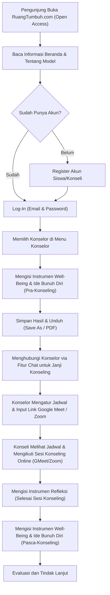

# Pemetaan Fitur, Alur, dan Konten Website RuangTumbuh.com

> **Judul Proyek/Riset:** Konstruksi Model Teoritis Konseling Online Bermuatan Nilai Kearifan Lokal untuk Meningkatkan Well-Being Remaja dengan Ide Bunuh Diri  
> **Nama Platform:** RuangTumbuh.com (Ruang Tumbuh / Ruang Bertumbuh)

---

## 1. Peta Alur Pengguna (User Flow)

Berdasarkan langkah layanan yang dirancang, berikut adalah alur utama perjalanan pengguna (**Konseli/Siswa** dan **Konselor**) di dalam sistem:

---

## 2. Struktur Navigasi / Menu Website

| Menu Utama | Sub-Bagian / Fungsi | Hak Akses |
| :--- | :--- | :--- |
| **Beranda** | Hero / Selamat Datang, Penjelasan Model RUANG TUMBUH, Tujuan Pengembangan, Keunggulan & Karakteristik, Langkah Akses Layanan | Publik (Open Access) |
| **Informasi** | Tentang Model, Tentang Pengembang (Profil & Foto), Alamat & Kontak | Publik (Open Access) |
| **Konseling Online** | Daftar Pilihan Konselor, Instrumen Well-Being & Ide Bunuh Diri (Awal/Sesudah), Fitur Chat Konselor, Jadwal & Link Google Meet/Zoom, Instrumen Refleksi, Evaluasi & Tindak Lanjut | Terautentikasi (Konseli & Konselor) |
| **Log-In / Register** | Halaman Masuk & Pendaftaran Akun Baru | Publik / Tamu |

---

## 3. Pemetaan Fitur Sistem Berdasarkan Peran (Role)

### A. Modul Autentikasi & Pengguna
1. **Akses Publik (Open Access):**
   - Pengunjung dapat mengakses halaman Beranda dan Informasi tanpa perlu login terlebih dahulu.
2. **Registrasi Konseli/Siswa:**
   - Form pendaftaran dengan atribut:
     - `Nama Lengkap`
     - `Jenis Kelamin`
     - `Kelas`
     - `Asal Sekolah`
     - `Username`
     - `Email`
     - `Password`
3. **Log-In:**
   - Autentikasi menggunakan `Email` (atau `Username`) dan `Password`.

---

### B. Modul Instrumen Well-Being dan Ide Bunuh Diri (Pre-Test & Post-Test)
1. **Identitas & Kategori Pengisian:**
   - Input/otomatis `Nama` konseli.
   - Pilihan jenis pengisian:
     - **Awal Konseling** (Sebelum sesi konseling)
     - **Sesudah Konseling** (Setelah rangkaian/sesi konseling selesai)
2. **Format Kuesioner / Pernyataan:**
   - Daftar item pernyataan instrumen *Well-Being* dan *Ide Bunuh Diri*.
   - Pilihan jawaban menggunakan skala Likert 5 opsi:
     1. `Sangat Setuju`
     2. `Setuju`
     3. `Netral`
     4. `Tidak Setuju`
     5. `Sangat Tidak Setuju`
3. **Penyimpanan & Ekspor Hasil:**
   - Fitur **Simpan Hasil** ke sistem/database.
   - Fitur **Save As / Unduh Hasil** (misal dalam format PDF/Cetak) setelah selesai mengisi.

---

### C. Modul Konseling Online (Pemilihan Konselor, Chat, & Penjadwalan)
1. **Direktori & Pemilihan Konselor:**
   - Menampilkan daftar **12 Konselor** yang tersedia.
   - Siswa dapat memilih konselor untuk memulai proses pendampingan.
2. **Fitur Chat (Konseli <-> Konselor):**
   - Setelah memilih konselor, siswa diarahkan ke ruang **Chat** dengan konselor tersebut untuk mendiskusikan dan menyepakati janji sesi konseling online.
3. **Manajemen Jadwal & Tautan Pertemuan (Oleh Konselor):**
   - Konselor memiliki fitur untuk mengatur jadwal sesi konseling (tanggal & waktu) serta menyematkan **Link Google Meet / Zoom** di website.
   - Jadwal dan link Google Meet / Zoom tersebut tampil di halaman konseli sehingga konseli dapat langsung mengaksesnya pada waktu yang ditentukan.

---

### D. Modul Instrumen Refleksi Pasca-Sesi
Diisi oleh konseli setiap selesai melaksanakan sesi konseling online. Berisi **3 pertanyaan terbuka (esai reflektif)**:
1. *"Apa pemahaman baru yang kamu dapatkan tentang pikiran, perasaan, atau cara memandang masalahmu setelah sesi konseling ini?"*
2. *"Nilai atau pelajaran apa dari pengalaman hidup, budaya, atau orang-orang yang mendukungmu yang dapat membantumu menghadapi masalah dengan lebih baik?"*
3. *"Apa satu langkah kecil yang akan kamu lakukan setelah sesi ini untuk merawat dirimu, menghadapi masalah, atau mencari dukungan ketika membutuhkannya?"*

---

### E. Modul Evaluasi dan Tindak Lanjut
- Membandingkan atau meninjau hasil instrumen *Well-Being* dan *Ide Bunuh Diri* sebelum vs. sesudah sesi konseling, serta hasil refleksi konseli untuk penentuan tindak lanjut oleh konselor.

---

## 4. Pemetaan Konten Teks per Halaman

### 4.1. Halaman Beranda

#### A. Hero / Sambutan Utama
**Judul:** Selamat Datang di Ruang Tumbuh  
**Isi Konten:**
> Platform ini merupakan pusat bantuan pelaksanaan konseling online dengan bermuatan nilai kearifan lokal untuk meningkatkan well-being pada remaja yang memiliki ide bunuh diri. Tujuan utama platform “Ruang Bertumbuh” adalah untuk membantu kamu dalam menyelesaikan permasalahan yang dihadapi dengan fokus pada peningkatan kondisi kesejahteraan psikologis atau well-being pada siswa yang berperan penting terhadap bagaimana kondisi kamu menghadapi tantangan ke depannya.
>
> RUANG TUMBUH merupakan model konseling online yang dikembangkan untuk mendukung peningkatan kesejahteraan psikologis (*psychological well-being*) remaja melalui pendekatan *Rational Emotive Behavior Therapy* (REBT) yang diperkaya dengan nilai-nilai kearifan lokal Indonesia. Model ini dirancang sebagai ruang pendampingan yang aman, suportif, dan inklusif bagi remaja untuk memahami pengalaman emosional, mengenali pola pikir yang kurang membantu, membangun keyakinan yang lebih rasional, serta menemukan kembali makna, kekuatan, dan harapan dalam kehidupannya.
>
> RUANG TUMBUH mengintegrasikan tiga komponen utama, yaitu pendekatan REBT sebagai mekanisme perubahan psikologis, nilai kearifan lokal sebagai sumber refleksi dan penguatan makna kehidupan, serta konsep *psychological well-being* dari Carol D. Ryff sebagai orientasi hasil yang ingin dikembangkan. Ketiga komponen tersebut dilaksanakan melalui media konseling online dengan tetap memperhatikan kebutuhan perkembangan remaja, kerahasiaan, etika profesi, dan keselamatan pengguna.

#### B. Tujuan Pengembangan RUANG TUMBUH
**Judul Seksi:** RUANG TUMBUH dikembangkan untuk:
1. Memfasilitasi remaja memahami pikiran, emosi, dan perilaku yang muncul ketika menghadapi masalah.
2. Membantu remaja mengenali dan mengevaluasi keyakinan yang tidak rasional atau tidak membantu perkembangan.
3. Mengembangkan keyakinan alternatif yang lebih rasional, fleksibel, dan mendukung kesehatan psikologis.
4. Mengintegrasikan nilai kearifan lokal sebagai sumber refleksi, dukungan sosial, dan penguatan makna kehidupan.
5. Mendukung pengembangan enam dimensi *psychological well-being* Ryff.
6. Memfasilitasi akses terhadap pendampingan konselor profesional melalui media online.
7. Membantu remaja mengenali sumber dukungan yang aman dan memperoleh bantuan profesional sesuai tingkat kebutuhannya.

#### C. Keunggulan dan Karakteristik Model
**Judul Seksi:** Keunggulan dan Karakteristik Model  
**Sub-teks:** RUANG TUMBUH memiliki beberapa karakteristik utama:
- **Berbasis teori:** mengintegrasikan REBT sebagai mekanisme perubahan dan model *psychological well-being* Ryff sebagai orientasi hasil.
- **Peka budaya:** memanfaatkan kearifan lokal secara kontekstual, reflektif, dan menghargai keberagaman pengalaman remaja.
- **Berorientasi pada kekuatan:** membantu remaja mengenali kemampuan, sumber dukungan, dan kemungkinan perubahan tanpa menyalahkan diri atas kesulitan yang dialami.
- **Menggunakan media online:** memperluas peluang akses terhadap informasi dan pendampingan, dengan tetap memperhatikan privasi, keamanan digital, dan keterbatasan layanan jarak jauh.
- **Mengutamakan keselamatan:** mengintegrasikan asesmen risiko, perencanaan keselamatan, dukungan sosial yang aman, dan rujukan profesional sesuai kebutuhan.
- **Mendorong perkembangan berkelanjutan:** menekankan proses belajar, refleksi, penerapan keterampilan, dan tindak lanjut sesuai kebutuhan individu.

#### D. Langkah untuk Mengakses Layanan Ruang Tumbuh
**Judul Seksi:** Langkah untuk Mengakses Layanan Ruang Tumbuh
1. Silakan register akun
2. Masuk melalui menu log-in
3. Memilih konselor
4. Mengisi instrumen Well-Being dan Ide Bunuh Diri sebelum sesi konseling
5. Melakukan Penjadwalan Konseling dengan Konselor yang Dipilih
6. Pengisian refleksi setiap selesai konseling online
7. Mengisi instrumen Well-Being dan Ide Bunuh Diri sesudah sesi konseling
8. Evaluasi dan Tindak Lanjut

---

### 4.2. Halaman Informasi (Tentang Model, Pengembang, & Kontak)

#### A. Tentang Model
> Model ini ditujukan terutama untuk mendukung remaja yang mengalami tekanan emosional, perasaan tidak berharga, kesulitan menghadapi masalah, kehilangan arah hidup, maupun pikiran tentang mengakhiri hidup. RUANG TUMBUH bukan sekadar ruang untuk menceritakan masalah, melainkan juga ruang untuk memahami diri, meninjau kembali cara berpikir, membangun strategi menghadapi kesulitan, dan mengembangkan hubungan yang lebih sehat dengan diri sendiri maupun orang lain.
>
> Melalui platform Ruang Tumbuh yang merupakan implikasi dari Konstruksi Model Teoritis Konseling Online Bermuatan Nilai Kearifan Lokal untuk Meningkatkan Well-Being Remaja dengan Ide Bunuh Diri diharapkan dapat mencegah permasalahan terkait dengan kesehatan mental dan menjadi pribadi yang memiliki kesehatan mental yang baik.

#### B. Tentang Pengembang
**Daftar Tim Pengembang:**
1. Prof. Dr. M. Ramli, M.A
2. Prof. Dr. Juntika Nurihsan, M.Pd
3. Prof. Dr. Zadrian Ardi, S.Pd., M.Pd., Kons
4. Prof. Dr. Nur Hidayah, M.Pd
5. Dr. Nur Mega Aris Saputra, S.Pd., M.Pd
6. Dr. Juwanto, S.Pd.I., M.Pd
7. Ade Herdian Putra, S.Pd., M.Pd. Kons

- **Aset Foto Pengembang:** [Google Drive Folder Foto](https://drive.google.com/drive/folders/1JIoHnBKOQku7OMwcKOv7DX58moAWOtUL?usp=drive_link)

#### C. Alamat & Kontak
- **Instansi:** Departemen Bimbingan dan Konseling FIP UM
- **Alamat:** Jl. Semarang No 5 Kota Malang
- **Kontak (Telepon/WA):** +62812-3175-0634
- **Email:** aris.saputra.fip@um.ac.id

---

### 4.3. Daftar Konselor (Menu Konseling Online)
Daftar 12 konselor yang tersedia untuk dipilih oleh siswa/konseli:
1. Prof. Dr. M. Ramli, M.A
2. Prof. Dr. Juntika Nurihsan, M.Pd
3. Prof. Dr. Nur Hidayah, M.Pd
4. Prof. Dr. Zadrian Ardi, S.Pd., M.Pd., Kons
5. Dr. Nur Mega Aris Saputra, S.Pd., M.Pd
6. Dr. Juwanto, S.Pd.I., M.Pd
7. Ade Herdian Putra, S.Pd., M.Pd. Kons
8. Nail Hidaya Afandi, S.Pd., M.Pd
9. Muh. Khoirudin Jalil, S.Pd., M.Pd
10. Alivia Eka Ariyanti, S.Pd., M.Pd
11. Muh Nur Alamsyah, S.Pd., M.Pd
12. Herlin Ika Nafilasari, S.Pd., M.Pd

---

## 5. Ringkasan Kebutuhan Tabel / Entitas Data (Gambaran Teknis)

Untuk mendukung seluruh alur di atas pada tahap modifikasi Laravel nantinya, berikut adalah komponen data utama yang dipetakan dari alur:
1. **`users` (Pengguna):** Menyimpan akun Siswa/Konseli (`nama`, `jenis_kelamin`, `kelas`, `asal_sekolah`, `username`, `email`, `password`, `role`) serta akun Konselor/Admin.
2. **`counselors` (Profil Konselor):** Data 12 konselor beserta foto, gelar, dan ketersediaan.
3. **`instruments` & `instrument_submissions` (Instrumen Well-Being & Ide Bunuh Diri):** Daftar butir pernyataan instrumen, tipe sesi (`pre` / awal konseling, `post` / sesudah konseling), jawaban skala Likert (1–5), skor hasil, dan fungsi unduh (`Save As`/PDF).
4. **`counseling_sessions` / `schedules` (Jadwal & Link Meet/Zoom):** Relasi konseli & konselor, waktu jadwal konseling, tautan `Google Meet / Zoom` yang diinput konselor, serta status sesi.
5. **`chats` / `messages` (Fitur Chat):** Pesan antara konseli dan konselor yang dipilih untuk menyepakati jadwal konseling.
6. **`reflections` (Instrumen Refleksi):** Jawaban 3 pertanyaan refleksi pasca-sesi konseling dari konseli.
