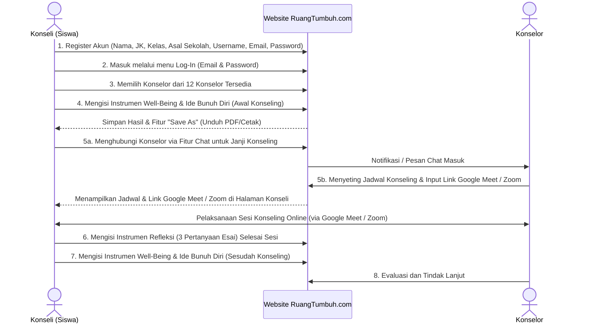
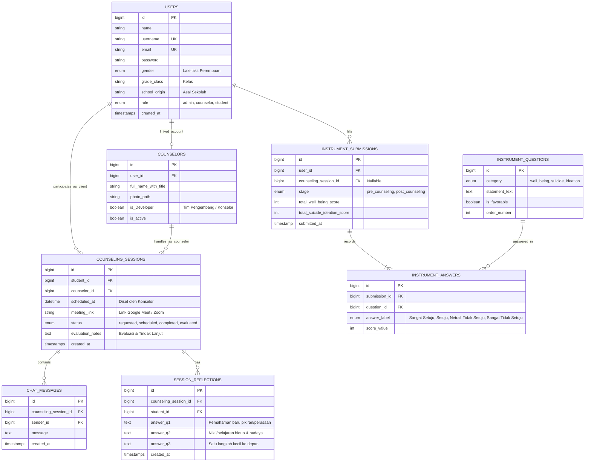

# Product Requirements Document (PRD) — RuangTumbuh.com

| Informasi Dokumen | Detail |
| :--- | :--- |
| **Nama Produk** | RuangTumbuh.com (Ruang Tumbuh / Ruang Bertumbuh) |
| **Judul Riset / Model** | Konstruksi Model Teoritis Konseling Online Bermuatan Nilai Kearifan Lokal untuk Meningkatkan Well-Being Remaja dengan Ide Bunuh Diri |
| **Platform Teknologi** | Web Application (Laravel Framework) |
| **Instansi Pengembang** | Departemen Bimbingan dan Konseling FIP Universitas Negeri Malang (UM) |
| **Status Dokumen** | Draft v1.0 |

---

## 1. Ringkasan Eksekutif & Ikhtisar Produk

### 1.1. Latar Belakang & Tujuan Produk
**RuangTumbuh.com** adalah platform pusat bantuan pelaksanaan konseling online bermuatan nilai kearifan lokal Indonesia yang dirancang untuk meningkatkan kesejahteraan psikologis (*psychological well-being*) pada remaja/siswa yang mengalami tekanan emosional maupun memiliki ide bunuh diri.

Model konseling **RUANG TUMBUH** mengintegrasikan **tiga komponen utama**:
1. **Pendekatan *Rational Emotive Behavior Therapy* (REBT):** Sebagai mekanisme perubahan psikologis untuk mengenali dan mengevaluasi keyakinan irasional serta membangun keyakinan alternatif yang rasional.
2. **Nilai Kearifan Lokal Indonesia:** Sebagai sumber refleksi, dukungan sosial, dan penguatan makna kehidupan secara kontekstual.
3. **Konsep *Psychological Well-Being* (Carol D. Ryff):** Sebagai orientasi hasil pengembangan enam dimensi kesejahteraan psikologis remaja.

### 1.2. Sasaran Pengembangan Platform
1. Memfasilitasi remaja memahami pikiran, emosi, dan perilaku yang muncul ketika menghadapi masalah.
2. Membantu remaja mengenali dan mengevaluasi keyakinan yang tidak rasional atau tidak membantu perkembangan.
3. Mengembangkan keyakinan alternatif yang lebih rasional, fleksibel, dan mendukung kesehatan psikologis.
4. Mengintegrasikan nilai kearifan lokal sebagai sumber refleksi, dukungan sosial, dan penguatan makna kehidupan.
5. Mendukung pengembangan enam dimensi *psychological well-being* Ryff.
6. Memfasilitasi akses terhadap pendampingan konselor profesional melalui media online.
7. Membantu remaja mengenali sumber dukungan yang aman dan memperoleh bantuan profesional sesuai tingkat kebutuhannya.

### 1.3. Prinsip & Karakteristik Utama Sistem
- **Berbasis Teori:** Integrasi REBT & *Psychological Well-Being* Ryff.
- **Peka Budaya:** Memanfaatkan kearifan lokal secara kontekstual dan reflektif.
- **Berorientasi pada Kekuatan:** Fokus pada kemampuan dan sumber dukungan remaja tanpa menyalahkan diri.
- **Menggunakan Media Online:** Akses mudah dengan menjaga privasi dan keamanan digital.
- **Mengutamakan Keselamatan:** Asesmen risiko (instrumen pra/pasca), perencanaan keselamatan, dan rujukan profesional.
- **Perkembangan Berkelanjutan:** Proses belajar, refleksi pasca-sesi, dan evaluasi tindak lanjut.

---

## 2. Peran Pengguna (User Roles & Personas)

| Peran Pengguna | Deskripsi | Hak Akses Utama |
| :--- | :--- | :--- |
| **1. Pengunjung Publik (Guest)** | Siswa/remaja, guru, atau masyarakat umum yang belum login. | - Mengakses halaman **Beranda** & **Informasi** (*Open Access*). - Melakukan **Registrasi** akun baru atau **Log-In**. |
| **2. Konseli / Siswa (Remaja)** | Siswa/remaja terdaftar yang membutuhkan layanan konseling online. | - Memilih konselor dari daftar 12 konselor. - Mengisi **Instrumen Well-Being & Ide Bunuh Diri** (Awal & Sesudah Konseling) serta mengunduh hasilnya (*Save As*). - Menghubungi konselor via **Fitur Chat** untuk janji temu. - Melihat jadwal konseling & mengakses **Link Google Meet / Zoom**. - Mengisi **Instrumen Refleksi** setiap selesai sesi konseling. - Melihat hasil evaluasi dan tindak lanjut. |
| **3. Konselor** | 12 Konselor profesional yang mendampingi konseli. | - Menerima pesan chat dari konseli & menyepakati jadwal. - Mengatur jadwal konseling dan menginput **Link Google Meet / Zoom**. - Melihat hasil pengisian instrumen Pra-Konseling, Pasca-Konseling, dan Refleksi milik konseli. - Memberikan catatan evaluasi dan tindak lanjut. |
| **4. Administrator** | Pengelola teknis platform. | - Mengelola data master konselor, butir pernyataan instrumen, akun pengguna, dan konten informasi. |

---

## 3. Arsitektur Navigasi & Alur Pengguna (User Journey)

### 3.1. Struktur Menu Utama Website
1. **Beranda** (*Open Access*)
2. **Konseling Online** (*Membutuhkan Log-In untuk aksi layanan*)
3. **Informasi** (*Open Access* — memuat Tentang Model, Tentang Pengembang, Alamat & Kontak)
4. **Log-In / Register** (*Open Access*)

### 3.2. Diagram Alur Layanan Utama (8 Langkah)

---

## 4. Kebutuhan Fungsional (Functional Requirements)

### FR-01: Halaman Publik — Beranda & Informasi (Open Access)
- **Deskripsi:** Halaman publik dapat diakses tanpa login untuk memperkenalkan model RUANG TUMBUH.
- **Spesifikasi Konten Beranda:**
  1. **Seksi Selamat Datang:** Menampilkan judul *"Selamat Datang di Ruang Tumbuh"* beserta 3 paragraf penjelasan platform dan integrasi 3 komponen utama (REBT, Kearifan Lokal, *Psychological Well-Being* Carol D. Ryff).
  2. **Seksi Tujuan Pengembangan:** Menampilkan 7 poin tujuan pengembangan RUANG TUMBUH.
  3. **Seksi Keunggulan & Karakteristik Model:** Menampilkan 6 karakteristik utama (*Berbasis teori, Peka budaya, Berorientasi pada kekuatan, Menggunakan media online, Mengutamakan keselamatan, Mendorong perkembangan berkelanjutan*).
  4. **Seksi Langkah Akses Layanan:** Menampilkan 8 tahapan mengakses layanan Ruang Tumbuh secara visual/berurutan.
- **Spesifikasi Konten Informasi:**
  1. **Tentang Model:** Menampilkan 2 paragraf penjelasan tujuan dan implikasi model konseling.
  2. **Tentang Pengembang:** Menampilkan profil & foto 7 tim pengembang (foto diambil dari [Google Drive Folder](https://drive.google.com/drive/folders/1JIoHnBKOQku7OMwcKOv7DX58moAWOtUL?usp=drive_link)).
  3. **Kontak & Alamat:** Menampilkan alamat Departemen BK FIP UM, nomor kontak (+62812-3175-0634), dan email (`aris.saputra.fip@um.ac.id`).

---

### FR-02: Autentikasi (Register & Log-In)
- **Deskripsi:** Sistem pendaftaran akun terbuka (*open access*) bagi siswa/remaja dan halaman masuk bagi pengguna terdaftar.
- **Atribut Form Registrasi Siswa:**
  1. `Nama` (Teks, Wajib)
  2. `Jenis Kelamin` (Pilihan: Laki-laki / Perempuan, Wajib)
  3. `Kelas` (Teks/Pilihan, Wajib)
  4. `Asal Sekolah` (Teks, Wajib)
  5. `Username` (Teks unik, Wajib)
  6. `Email` (Format email unik, Wajib)
  7. `Password` (Terenkripsi, Wajib)
- **Atribut Form Log-In:**
  - Masuk menggunakan `Email` (atau `Username`) dan `Password`.

---

### FR-03: Direktori & Pemilihan Konselor
- **Deskripsi:** Konseli yang sudah login dapat melihat daftar 12 konselor yang tersedia di menu Konseling Online dan memilih salah satu konselor.
- **Kriteria Penerimaan (Acceptance Criteria):**
  - Menampilkan kartu profil 12 konselor (Nama lengkap beserta gelar & foto).
  - Tombol **"Pilih Konselor"** yang mengarahkan konseli ke alur pengisian instrumen awal dan/atau ruang **Chat** bersama konselor yang dipilih.

---

### FR-04: Instrumen Well-Being dan Ide Bunuh Diri (Awal & Sesudah Konseling)
- **Deskripsi:** Formulir asesmen mandiri untuk mengukur tingkat *Psychological Well-Being* dan *Ide Bunuh Diri* sebelum dan sesudah mengikuti layanan konseling.
- **Komponen Input:**
  1. **Nama:** Terisi otomatis dari akun yang login atau dapat diinput.
  2. **Pilihan Tahap Pengisian:**
     - `Awal Konseling` (Pre-Test / Sebelum sesi konseling)
     - `Sesudah Konseling` (Post-Test / Setelah sesi konseling)
  3. **Daftar Pernyataan & Skala Jawaban:**
     - Setiap butir pernyataan memiliki 5 opsi jawaban skala Likert:
       - `Sangat Setuju`
       - `Setuju`
       - `Netral`
       - `Tidak Setuju`
       - `Sangat Tidak Setuju`
- **Output & Penyimpanan:**
  - **Simpan Hasil:** Menyimpan respons dan kalkulasi skor ke database.
  - **Save As (Unduh/Cetak):** Setelah mengisi, konseli dapat menyimpan salinan hasil pengisian ke perangkat mereka (misal: ekspor ke PDF atau cetak halaman).

---

### FR-05: Fitur Chat Konseli & Konselor
- **Deskripsi:** Media komunikasi pesan teks di dalam website antara konseli dan konselor yang dipilih untuk membuat kesepakatan janji konseling online.
- **Kriteria Penerimaan:**
  - Setelah memilih konselor, siswa diarahkan ke halaman chat dengan konselor tersebut.
  - Siswa dan konselor dapat mengirim dan membaca pesan terkait kesediaan waktu konseling.

---

### FR-06: Penjadwalan Konseling & Link Google Meet / Zoom
- **Deskripsi:** Fitur bagi konselor untuk menetapkan jadwal sesi konseling dan membagikan tautan ruang pertemuan virtual.
- **Kriteria Penerimaan:**
  - **Sisi Konselor:** Form pengaturan jadwal (Tanggal, Waktu Mulai/Selesai, Platform: Google Meet / Zoom, dan URL Link Meeting).
  - **Sisi Konseli:** Dapat melihat jadwal konseling yang telah diset oleh konselor beserta tombol/tautan aktif menuju **Google Meet / Zoom** langsung dari dashboard/halaman konseling mereka.

---

### FR-07: Instrumen Refleksi Pasca-Sesi Konseling
- **Deskripsi:** Formulir refleksi yang wajib diisi oleh konseli setiap selesai mengikuti satu sesi konseling online.
- **Pertanyaan Instrumen Refleksi:**
  1. *"Apa pemahaman baru yang kamu dapatkan tentang pikiran, perasaan, atau cara memandang masalahmu setelah sesi konseling ini?"*
  2. *"Nilai atau pelajaran apa dari pengalaman hidup, budaya, atau orang-orang yang mendukungmu yang dapat membantumu menghadapi masalah dengan lebih baik?"*
  3. *"Apa satu langkah kecil yang akan kamu lakukan setelah sesi ini untuk merawat dirimu, menghadapi masalah, atau mencari dukungan ketika membutuhkannya?"*
- **Kriteria Penerimaan:**
  - Jawaban tersimpan per sesi konseling dan dapat ditinjau kembali oleh konseli maupun konselor pendampingnya.

---

### FR-08: Evaluasi dan Tindak Lanjut
- **Deskripsi:** Tahap akhir siklus konseling untuk melihat perkembangan konseli berdasarkan hasil instrumen sebelum konseling, refleksi tiap sesi, dan instrumen sesudah konseling.
- **Kriteria Penerimaan:**
  - Menampilkan rekapitulasi pengisian instrumen (*Awal Konseling* vs. *Sesudah Konseling*) serta riwayat refleksi.
  - Konselor dapat memberikan catatan evaluasi atau rekomendasi tindak lanjut.

---

## 5. Rancangan Struktur Database (Target Modifikasi Laravel)

Berikut adalah rancangan entitas tabel untuk implementasi di proyek Laravel:

---

## 6. Data Master Awal (Seeder Data)

### 6.1. Daftar Tim Pengembang (7 Orang)
1. Prof. Dr. M. Ramli, M.A
2. Prof. Dr. Juntika Nurihsan, M.Pd
3. Prof. Dr. Zadrian Ardi, S.Pd., M.Pd., Kons
4. Prof. Dr. Nur Hidayah, M.Pd
5. Dr. Nur Mega Aris Saputra, S.Pd., M.Pd
6. Dr. Juwanto, S.Pd.I., M.Pd
7. Ade Herdian Putra, S.Pd., M.Pd. Kons

### 6.2. Daftar Konselor Tersedia (12 Orang)
1. Prof. Dr. M. Ramli, M.A
2. Prof. Dr. Juntika Nurihsan, M.Pd
3. Prof. Dr. Nur Hidayah, M.Pd
4. Prof. Dr. Zadrian Ardi, S.Pd., M.Pd., Kons
5. Dr. Nur Mega Aris Saputra, S.Pd., M.Pd
6. Dr. Juwanto, S.Pd.I., M.Pd
7. Ade Herdian Putra, S.Pd., M.Pd. Kons
8. Nail Hidaya Afandi, S.Pd., M.Pd
9. Muh. Khoirudin Jalil, S.Pd., M.Pd
10. Alivia Eka Ariyanti, S.Pd., M.Pd
11. Muh Nur Alamsyah, S.Pd., M.Pd
12. Herlin Ika Nafilasari, S.Pd., M.Pd

---

## 7. Kebutuhan Non-Fungsional (Non-Functional Requirements)
1. **Desain Antarmuka Ramah Remaja (Youth-Friendly & Supportive UI/UX):** Menggunakan warna yang menenangkan, suportif, tidak menghakimi, serta navigasi yang jelas bagi siswa.
2. **Kerahasiaan & Privasi (Confidentiality):** Data hasil instrumen, chat, dan refleksi konseli hanya dapat diakses oleh konseli yang bersangkutan dan konselor yang menanganinya.
3. **Responsivitas (Mobile-First):** Mengingat mayoritas remaja mengakses melalui *smartphone*, seluruh halaman (instrumen, chat, jadwal link Meet/Zoom, dan refleksi) harus responsif di perangkat mobile maupun desktop.
4. **Kemudahan Ekspor (*Save As*):** Fitur simpan/unduh hasil instrumen harus bekerja dengan baik di browser desktop maupun mobile (PDF generator atau *print-friendly view*).
