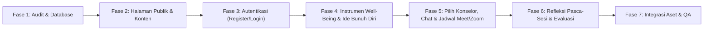

# Roadmap & Daftar Tugas Pengembangan (TASK) — RuangTumbuh.com

Dokumen ini berisi peta jalan (*roadmap*) dan rincian daftar tugas (*task list*) terstruktur berdasarkan [PRD.md](file:///d:/Project/ruangtumbuh/development/PRD.md) dan [PEMETAAN_FITUR_DAN_KONTEN.md](file:///d:/Project/ruangtumbuh/development/PEMETAAN_FITUR_DAN_KONTEN.md) untuk memodifikasi proyek Laravel yang ada menjadi platform **RuangTumbuh.com**.

---

## Ringkasan Fase Pengembangan (Roadmap)

---

## Fase 1: Audit Proyek Eksisting & Persiapan Database
Tujuan: Memahami struktur proyek Laravel saat ini dan menyiapkan skema database serta data awal (*seeder*) tanpa merusak fitur yang masih relevan.

- [x] **1.1. Audit Proyek Laravel Eksisting**
  - [x] Memeriksa versi Laravel, struktur `routes/web.php`, `app/Models`, `app/Http/Controllers`, dan `database/migrations`.
  - [x] Memetakan komponen/fitur lama yang dapat digunakan ulang (*reuse*), dimodifikasi, atau diganti.
- [x] **1.2. Pembuatan / Modifikasi Migration & Model**
  - [x] **Tabel `users`**: Memastikan ketersediaan kolom `name` (Nama), `gender` (Jenis Kelamin), `grade_class` (Kelas), `school_origin` (Asal Sekolah), `username`, `email`, `password`, dan `role` (`konseli`, `konselor`, `admin`).
  - [x] **Tabel `counselor_profiles`**: Menyimpan profil konselor/pengembang (`user_id`, `description`, `motto`, `photo_path`, `whatsapp_number`, `is_developer`, `is_active`, `order_number`).
  - [x] **Tabel `questions`**: Menyimpan butir pernyataan instrumen (`category`: `well_being` / `suicide_ideation`, `dimension`).
  - [x] **Tabel `wellbeing_answers` & `wellbeing_answer_details`**: Menyimpan riwayat pengisian (`pre_test` = `Awal Konseling` / `post_test` = `Sesudah Konseling`), jawaban skala Likert 5 poin, `total_score`, `well_being_score`, dan `suicide_ideation_score`.
  - [x] **Tabel `counseling_sessions`**: Menyimpan pemilihan konselor oleh siswa, status sesi, jadwal waktu konseling, platform & link **Google Meet / Zoom**, serta catatan evaluasi (`counselor_evaluation_notes`).
  - [x] **Tabel `chat_messages`**: Menyimpan percakapan chat antara konseli dan konselor untuk membuat janji konseling.
  - [x] **Tabel `session_reflections`**: Menyimpan jawaban 3 pertanyaan refleksi setiap selesai sesi konseling online.
- [x] **1.3. Pembuatan Data Seeder (`DatabaseSeeder`)**
  - [x] Seeder **7 Tim Pengembang** dan **12 Konselor** beserta akun login konselor (`CounselorSeeder`).
  - [x] Seeder butir pernyataan **Instrumen Well-Being dan Ide Bunuh Diri** (`WellbeingQuestionSeeder`).

---

## Fase 2: Navigasi Utama & Halaman Publik (*Open Access* — FR-01)
Tujuan: Membangun halaman depan dan halaman informasi yang dapat diakses secara terbuka (*open access*) sesuai konten resmi RuangTumbuh.com.

- [x] **2.1. Pembuatan Layout Utama & Menu Navigasi**
  - [x] Menyusun menu navigasi atas (Navbar): **Beranda**, **Konseling Online**, **Informasi**, serta tombol **Log-In / Register**.
  - [x] Menyusun Footer yang memuat informasi singkat instansi, alamat, dan kontak Departemen BK FIP UM.
- [x] **2.2. Implementasi Halaman Beranda (`/`)**
  - [x] **Seksi Hero / Selamat Datang**: Menampilkan judul *"Selamat Datang di Ruang Tumbuh"* dan 3 paragraf deskripsi platform (integrasi REBT, Kearifan Lokal, dan *Psychological Well-Being* Carol D. Ryff).
  - [x] **Seksi Tujuan Pengembangan**: Menampilkan 7 poin tujuan pengembangan RUANG TUMBUH.
  - [x] **Seksi Keunggulan dan Karakteristik Model**: Menampilkan 6 kartu/poin karakteristik (*Berbasis teori, Peka budaya, Berorientasi pada kekuatan, Menggunakan media online, Mengutamakan keselamatan, Mendorong perkembangan berkelanjutan*).
  - [x] **Seksi Langkah Mengakses Layanan**: Menampilkan 8 tahapan alur layanan secara berurutan dan interaktif.
- [x] **2.3. Implementasi Halaman Informasi (`/informasi`)**
  - [x] **Seksi Tentang Model**: Menampilkan 2 paragraf penjelasan tentang model konseling RUANG TUMBUH.
  - [x] **Seksi Tentang Pengembang**: Menampilkan daftar 7 pengembang beserta foto profil:
    1. Prof. Dr. M. Ramli, M.A
    2. Prof. Dr. Juntika Nurihsan, M.Pd
    3. Prof. Dr. Zadrian Ardi, S.Pd., M.Pd., Kons
    4. Prof. Dr. Nur Hidayah, M.Pd
    5. Dr. Nur Mega Aris Saputra, S.Pd., M.Pd
    6. Dr. Juwanto, S.Pd.I., M.Pd
    7. Ade Herdian Putra, S.Pd., M.Pd. Kons
  - [x] **Seksi Alamat & Kontak**:
    - Departemen Bimbingan dan Konseling FIP UM, Jl. Semarang No 5 Kota Malang
    - Kontak: `+62812-3175-0634`
    - Email: `aris.saputra.fip@um.ac.id`

---

## Fase 3: Sistem Autentikasi — Register & Log-In (FR-02)
Tujuan: Memfasilitasi pendaftaran akun siswa/konseli baru dan akses masuk ke platform.

- [x] **3.1. Halaman & Logika Registrasi Siswa (`/register`)**
  - [x] Membuat form pendaftaran dengan 7 field wajib:
    - `Nama` (`name`)
    - `Jenis Kelamin` (`gender`)
    - `Kelas` (`grade_class`)
    - `Asal Sekolah` (`school_origin`)
    - `Username` (`username`)
    - `Email` (`email`)
    - `Password` (`password`)
  - [x] Validasi input dan pembuatan akun otomatis dengan peran sebagai Konseli/Siswa.
- [x] **3.2. Halaman & Logika Log-In (`/login`)**
  - [x] Form masuk menggunakan `Email` (atau `Username`) dan `Password`.
  - [x] Pengaturan *redirect* setelah login:
    - **Konseli/Siswa** $\rightarrow$ Dashboard / Menu Konseling Online.
    - **Konselor** $\rightarrow$ Dashboard Konselor (Manajemen Chat, Jadwal Meet/Zoom, & Review Konseli).

---

## Fase 4: Modul Instrumen Well-Being & Ide Bunuh Diri (FR-04)
Tujuan: Menyediakan instrumen pengukuran sebelum (*Pre-Test*) dan sesudah (*Post-Test*) sesi konseling beserta fitur simpan & *Save As*.

- [x] **4.1. Form Pengisian Instrumen**
  - [x] Field `Nama` konseli.
  - [x] Pilihan tahap pengisian: **Awal Konseling** (sebelum sesi) atau **Sesudah Konseling** (setelah sesi).
  - [x] Daftar pernyataan dengan 5 pilihan radio button skala Likert:
    - `Sangat Setuju`
    - `Setuju`
    - `Netral`
    - `Tidak Setuju`
    - `Sangat Tidak Setuju`
- [x] **4.2. Penyimpanan Hasil & Fitur *Save As* (Unduh/Cetak)**
  - [x] Menyimpan jawaban dan skor ke database.
  - [x] Menampilkan halaman ringkasan hasil setelah submit.
  - [x] Menyediakan tombol **Simpan / Save As** (Unduh PDF atau Cetak Hasil Pengisian Instrumen).

---

## Fase 5: Direktori Konselor, Fitur Chat, & Penjadwalan Konseling Online (FR-03, FR-05, FR-06)
Tujuan: Memfasilitasi pemilihan 12 konselor, komunikasi janji temu via chat, dan pembagian link Google Meet / Zoom oleh konselor.

- [x] **5.1. Halaman Pemilihan Konselor (Menu Konseling Online)**
  - [x] Menampilkan daftar **12 Konselor** yang tersedia:
    1. Prof. Dr. M. Ramli, M.A
    2. Prof. Dr. Juntika Nurihsan, M.Pd
    3. Prof. Dr. Nur Hidayah, M.Pd
    4. Prof. Dr. Zadrian Ardi, S.Pd., M.Pd., Kons
    5. Dr. Nur Mega Aris Saputra, S.Pd., M.Pd
    6. Dr. Juwanto, S.Pd.I., M.Pd
    7. Ade Herdian Putra, S.Pd., M.Pd. Kons
    8. Nail Hidaya Afandi, S.Pd., M.Pd
    9. Muh. Khoirudin Jalil, S.Pd., M.Pd
    10. Alivia Eka Ariyanti, S.Pd., M.Pd
    11. Muh Nur Alamsyah, S.Pd., M.Pd
    12. Herlin Ika Nafilasari, S.Pd., M.Pd
  - [x] Alur memilih konselor: Mengarahkan konseli ke ruang Chat & Penjadwalan Konseling bersama konselor yang dipilih.
- [x] **5.2. Fitur Chat Janji Konseling (Konseli $\leftrightarrow$ Konselor)**
  - [x] Setelah memilih konselor, siswa diarahkan ke fitur **Chat** dengan konselor tersebut untuk menyepakati jadwal konseling online.
  - [x] Halaman chat di sisi Konselor untuk membalas pesan konseli.
- [x] **5.3. Fitur Penjadwalan & Link Google Meet / Zoom**
  - [x] **Sisi Konselor**: Form untuk menyeting jadwal konseling (Tanggal & Jam) serta menginput tautan **Google Meet / Zoom**.
  - [x] **Sisi Konseli**: Tampilan informasi jadwal konseling dan tombol/link **Google Meet / Zoom** yang dapat diklik langsung oleh konseli pada jadwal yang ditentukan.

---

## Fase 6: Modul Instrumen Refleksi & Evaluasi Tindak Lanjut (FR-07, FR-08)
Tujuan: Memfasilitasi pengisian refleksi pasca-sesi konseling dan evaluasi perkembangan konseli.

- [x] **6.1. Form Instrumen Refleksi Pasca-Sesi**
  - [x] Membuat form refleksi yang diisi konseli setiap selesai sesi konseling online, memuat 3 pertanyaan utama:
    1. *"Apa pemahaman baru yang kamu dapatkan tentang pikiran, perasaan, atau cara memandang masalahmu setelah sesi konseling ini?"*
    2. *"Nilai atau pelajaran apa dari pengalaman hidup, budaya, atau orang-orang yang mendukungmu yang dapat membantumu menghadapi masalah dengan lebih baik?"*
    3. *"Apa satu langkah kecil yang akan kamu lakukan setelah sesi ini untuk merawat dirimu, menghadapi masalah, atau mencari dukungan ketika membutuhkannya?"*
  - [x] Menyimpan riwayat refleksi per sesi konseling.
- [x] **6.2. Halaman Evaluasi dan Tindak Lanjut**
  - [x] Mengarahkan konseli untuk mengisi **Instrumen Well-Being dan Ide Bunuh Diri (Sesudah Konseling)** setelah rangkaian sesi selesai.
  - [x] Menampilkan perbandingan hasil instrumen (`Awal Konseling` vs `Sesudah Konseling`) serta jawaban refleksi di dashboard Konselor & Konseli.
  - [x] Fitur input catatan evaluasi & tindak lanjut oleh Konselor.

---

## Fase 7: Integrasi Aset Foto, UI/UX Polish, & Pengujian Akhir
Tujuan: Memastikan seluruh tampilan rapi, responsif, dan seluruh 8 langkah layanan berjalan lancar.

- [ ] **7.1. Integrasi Aset Foto Pengembang & Konselor (Menunggu Input Manual User)**
  - [x] Direktori aset foto telah disiapkan di `public/image/team/` dan `public/image/counselors/` dengan *fallback* avatar inisial otomatis apabila file foto belum dimasukkan.
- [x] **7.2. Pengujian Alur 8 Langkah (*End-to-End Verification*)**
  - [x] Uji Langkah 1 & 2: Register akun siswa baru $\rightarrow$ Log-In.
  - [x] Uji Langkah 3 & 4: Memilih konselor $\rightarrow$ Mengisi instrumen *Well-Being* & *Ide Bunuh Diri* sebelum konseling + *Save As*.
  - [x] Uji Langkah 5: Chat konselor $\rightarrow$ Konselor set jadwal & link Google Meet/Zoom $\rightarrow$ Konseli melihat link.
  - [x] Uji Langkah 6: Mengisi instrumen refleksi selesai sesi konseling.
  - [x] Uji Langkah 7 & 8: Mengisi instrumen sesudah konseling $\rightarrow$ Evaluasi dan Tindak Lanjut.
